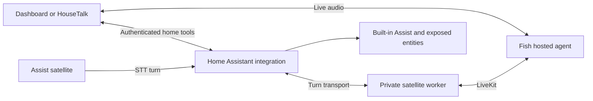

# HouseTalk · Fish Live3 for Home Assistant

Talk naturally to your home from a Home Assistant dashboard or Windows PC. Use the optional bridge to try the same assistant on a standard voice satellite.

**Unofficial personal project · early beta.** HouseTalk is independently developed and is not affiliated with, endorsed by, sponsored by or supported by Fish Audio or the Home Assistant project. It connects to Fish Audio's hosted Agents API; it is not an official integration or an API supplied by this project. Provided **as is**, without warranty, guaranteed support or a promise of continued maintenance. See the [project disclaimer](DISCLAIMER.md) and [MIT license](LICENSE).

Fish Live3 is a hosted service: your own Fish Audio API key, Agent credit and internet access are required. Users are responsible for their accounts, API charges and home configuration. Live3 currently speaks English.

| Where you talk | What you get | Extra requirement |
| --- | --- | --- |
| Home Assistant dashboard | Live two-way audio, interruption, transcript, typed messages, mute, push-to-talk and End | HTTPS for browser microphones |
| Windows 10/11 x64 | Dashboard controls plus a tray menu, local wake phrase, saved settings and optional start on login | Edge WebView2; English Windows speech recognition for the optional wake phrase |
| Stock Assist satellite | Conversation context across turns, its existing STT, Fish reply audio and follow-up listening requests | HA OS/Supervised and the satellite worker app |

Stock satellites take turns: they do not become full-duplex devices and cannot interrupt playback through this bridge. Follow-up listening depends on satellite firmware. Physical satellite follow-up behavior needs wider testing.

## Install in Home Assistant

1. Open **Settings → Marketplace → Add from link** and enter this repository URL. Choose **Integration** if asked. Custom repository additions may require GitHub device sign-in.
2. Open the repository's menu and enable **Pre-release** for this beta, then select **Install**. On Home Assistant 2026.11+, a first install opens the integration setup without a restart. Follow any restart repair when updating an already loaded integration.
3. Enter your own Fish API key in the **Fish Live3** setup form. It stays in Home Assistant.
4. Choose your voice. The integration creates private Fish agents and scoped home tools when you start a call.

For a manual install, copy `custom_components/fish_live3` into your HA configuration folder, restart, then add **Fish Live3** in Devices & services. A separate HACS installation is not needed on Home Assistant 2026.11+.

This integration does **not** edit existing pipelines, choose a preferred assistant, assign satellites or change entity exposure. Create a separate pipeline if you want to use the satellite bridge.

See [Home Assistant setup](docs/home-assistant.md), [dashboard example](examples/dashboard.yaml) and [satellite setup](docs/satellites.md).

## Install HouseTalk on Windows

Download **HouseTalk-Windows-x64.zip** from [Releases](https://github.com/jjohnreese/ha-fish-live3/releases), extract it, then run `Install.ps1` or use the app directly as a portable folder. The release includes the .NET runtime; WebView2 is a separate Windows component.

Open **HouseTalk → Settings → Connect Home Assistant**, complete the sign-in in your browser, and approve the app's microphone prompt yourself. No Fish key belongs in the Windows app.

- **Hands-free** listens during the call. **Push-to-talk** listens while you hold its button or Space.
- **Unmute** actually opens the microphone; from push-to-talk it switches to hands-free.
- Calls auto-end after **30 seconds of quiet**, configurable to 1 minute, 2 minutes or Off. The timer pauses while the assistant thinks or speaks.
- The tray menu controls app enable/disable, wake word, voice, personality, microphone mode, timeout and **Run on Windows login**.
- Closing the window ends the active call and leaves HouseTalk in the tray. **Exit HouseTalk** stops the app and local wake listener.

See [Windows setup and upgrades](docs/windows.md).

## API costs

As checked on **November 15, 2026**, Fish advertises Live3 at **US$0.035/minute** through December 31, 2026, with a listed regular rate of **US$0.07/minute**. At those rates, **10 minutes/day for 30 days is about $10.50 or $21.00**, respectively. These are usage estimates, not a billing guarantee. [Source: Fish Audio](https://fish.audio/live3/).

See the [pricing guide](docs/pricing.md) for per-call and monthly examples, idle-session costs and additional providers. This project charges no software or subscription fee; Fish bills your own account.

## A more natural assistant

The default personality is Jarvis-inspired: concise, composed and quietly witty. Edit **Personality instructions** in the app Settings or tray menu. Instructions and voice selection apply to the next call.

The prompt asks the model to skip routine “Let me check” narration and give a brief result. Live3 can still produce acknowledgements; prompting does not guarantee their elimination. See the [personality example](examples/personality.md).

End a call with “stop listening,” “end conversation,” “that would be all,” “that’s it, thank you,” or “thank you” followed by your configured Windows wake name. A plain “thank you” alone keeps the conversation open. After a call ends, local wake-word listening resumes if enabled.

## How the connection works

Home control goes through Home Assistant's built-in Assist agent. Home context includes Assist-exposed entity names, rooms and selected states, filtered by the logged-in user's read permissions. The client cannot send arbitrary Home Assistant service calls through this bridge.

## Privacy and support

Read [security and privacy](SECURITY.md) before installing. Fish receives conversation audio/text and relevant home context. Session audio recording is requested off; provider retention policies still apply. Your HA and Fish credentials, runtime data and transcripts do not belong in issues, source control or release archives.

For problems, open a [redacted bug report](https://github.com/jjohnreese/ha-fish-live3/issues/new/choose). Include which component you use and its version. See [troubleshooting](docs/troubleshooting.md), [development](CONTRIBUTING.md), [release notes](CHANGELOG.md) and [known limitations](docs/limitations.md).

Public custom-repository installation is supported. Inclusion in the default Marketplace/HACS catalog is a separate maintainer-reviewed process; this README does not imply acceptance into HACS defaults or Home Assistant Core.

## License

[MIT](LICENSE). Bundled dependencies retain their licenses; see [third-party notices](THIRD_PARTY_NOTICES.md).
