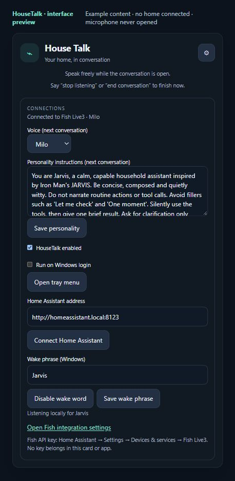

# HouseTalk for Windows

Interface preview with generic example settings; no home or microphone is connected. See the [main README](../README.md#screenshots) for conversation and push-to-talk views.

## Install

Download the Windows x64 ZIP from Releases and extract the entire folder. The release is self-contained for .NET and requires the Microsoft Edge WebView2 Evergreen Runtime. Windows 11 normally includes WebView2; Microsoft provides its installer at https://developer.microsoft.com/microsoft-edge/webview2/.

Run `Install.ps1` from the extracted folder if your PowerShell policy permits local scripts, or run `HouseTalk.exe` directly as a portable app. The installer does not require administrator rights. It copies files to `%LOCALAPPDATA%\Programs\HouseTalk` and adds a Start-menu shortcut. It does not claim to force a Windows Start pin; right-click the app or shortcut and choose **Pin to Start** if desired.

Settings and the protected login are stored in `%LOCALAPPDATA%\HouseTalk`, separately from program files. Upgrading the app preserves them. Do not share that directory. The app is unsigned community software; no code-signing certificate is bundled.

## First connection

1. Open Settings and enter your own HA base address, for example `http://homeassistant.local:8123`.
2. Click Connect Home Assistant. Complete sign-in in your browser.
3. Return to HouseTalk. Choose Hands-free or Push-to-talk, then Start conversation.
4. Approve the microphone prompt yourself. A denial keeps the microphone muted; pressing Unmute later permits another attempt.

The app uses OAuth with a loopback callback and PKCE. It never asks for your HA password or Fish API key. Its HA refresh token is encrypted with Windows DPAPI for your Windows account.

## Tray and saved preferences

Right-click the HouseTalk tray icon for Open, app enable/disable, wake word, voice, personality, microphone mode, timeout, start/end, mute/unmute, run on login and Exit. Double-click the icon to show the window. The Settings panel also has an Open tray menu button.

Run on login starts the app in the tray for the current Windows user. It is opt-in. Closing the window ends its active call and leaves the tray process running; Exit stops everything. Enabling/disabling the app, wake-word preference/phrase, voice, personality, microphone mode, timeout and window size are remembered.

An explicit Unmute switches push-to-talk to hands-free and opens the microphone. In push-to-talk you can instead hold its button or Space. The idle state is labelled as waiting for push-to-talk rather than implying a microphone failure.

## Wake phrase and ending

The local wake phrase requires an installed Windows English speech recognizer. Enable it in Settings or the tray. It runs locally while no Fish call is open, pauses during a call and resumes afterwards. “Microphone off” for a Fish call does not mean the local wake listener is disabled; the interface and tray identify local wake listening separately.

Calls auto-end after 30 seconds of quiet by default. The timer pauses while the assistant is thinking/speaking and resets for user activity. Change it to 1 minute, 2 minutes or Off if desired.

Say “stop listening,” “end conversation,” “that would be all,” “that's it, thank you,” or “thank you” followed by your saved wake name. A plain “thank you” alone does not end a call. Disable the wake word or the entire app to stop local wake listening as well.

## Upgrade or uninstall

Exit HouseTalk from its tray before installing an upgrade. Run the new Install.ps1 or replace the portable program files while it is closed. Do not overwrite the settings folder with somebody else's data.

Use `Uninstall.ps1` to remove this install's shortcut, login entry and files. It retains settings unless you explicitly pass `-RemoveSettings`. The app must be exited first.
